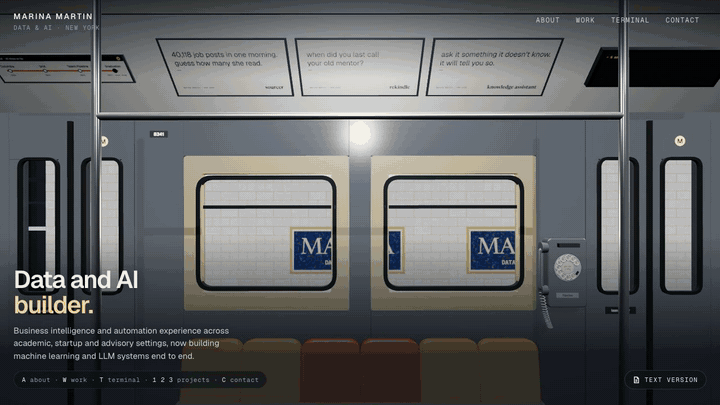

# Marina Martin

**Data and AI builder in New York.** Business intelligence and automation experience across academic, startup and advisory settings, now building machine learning and LLM systems end to end.

My portfolio is a New York subway car. Ride it to each project and read the poster on the platform.

**[Visit my portfolio](https://marinasofia.github.io/)** · [LinkedIn](https://www.linkedin.com/in/marinasofiaml/)

### Projects

- **[Sourcer](https://github.com/marinasofia/sourcer)** reads thousands of company job boards every morning, sets aside what cannot fit with plain rules and has an LLM judge the rest against my own work history.
- **[Knowledge Assistant](https://github.com/marinasofia/knowledge-assistant)** answers questions from company documents with exact citations, and says so when it does not know.
- **[Statement Agent](https://github.com/marinasofia/statement-agent)** is a LangGraph agent that turns PDF bank statements into validated Excel reports.
